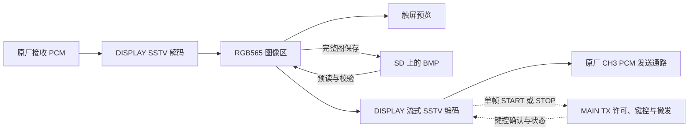

# FTX-1 机内 SSTV 收发调研与开发交接

调研日期为 2026-11-19。目标是在现有 FTX-1 上接收、显示和发送静态彩色 SSTV 图像。先实现 **Robot 36 单模式**，并保留 FT8、CW_DEC、SWR SCAN 及原厂功能。开发由 Gemini 执行，代码、镜像与测试证据交回 Codex 审计。可直接发给 Gemini 的文字见 [实施提示词](Gemini提示词.md)。

## 1. 结论与建议路线

**现有硬件具备完成 Robot 36 的必要能力，预计无需加装硬件。** DISPLAY 已有可供算法使用的 16 kHz PCM、可显示 RGB565 的 800×480 触屏及 SD 文件接口。其 Cortex-A9 适合开展逐行解码和连续音调合成，最终实时余量需量化。现有 FT8 的 MAIN 键控与 DISPLAY PCM 发射链证明了这个方向具备可复用的接口。Robot 36 的完整机内收发、长发射期间的音频连续性和故障撤发仍待验证。

**先做离线收发验证，并行查 Flash 和 RAM，首个机内里程碑做 RX。** 当前联合版 DISPLAY 的两个可执行区分别只余 66 B 和 8 B，无法直接追加完整功能。13.5 秒的 FT8 发射租约也装不下一帧 SSTV。联合版需要先明确可用的代码区和缓冲区，再验证独立的 SSTV 租约能在故障时结束发射。各项测试结果须注明运行环境是宿主、整机仿真还是实机台架。

首版范围建议如下。

- RX 自动识别 Robot 36 的 VIS，逐行显示 320×240 图像，明确区分完成、部分和取消。完整图可显式存入 SD。只监听当前主接收源。
- TX 从 SD 预读一张 320×240、24-bit、未压缩 BMP，先显示预览，再由用户明确发一帧。内置合成色条可作开发和台架基准。支持随时停止、超时和回到 RX。
- 原厂 VFO 与工作模式继续作为射频操作入口。首轮实机验证用 USB，DATA-U 作为后续资格测试。扩展 Robot 72、Martin、Scottie、PD、JPEG/PNG 和更多操作模式，需分别评估算力、代码空间及发射时长。
- UI 最终通过 `DISPLAY SETTING → BUTTON SETUP` 分配 `SSTV`。SSTV 与 FT8、CW_DEC、SWR SCAN 共用一个模式所有权。平时从主画面打开，结束后恢复当时的原厂画面和软键。

## 2. 已核对的基线

以 [ft8-cw-swr-fix 发布说明](../reproduce.md) 的联合版为准。它是当前带 BUTTON SETUP、SWR 和修复后 FT8/CW 的主线。旧 [开发交接](../analysis.md) 仍可查音频、时钟和早期实机记录，涉及菜单、扩展字节和代码余量时，以当前源码与以下镜像为依据。

| 镜像 | SHA-256 |
| --- | --- |
| DISPLAY V01-10 | `d869e0799add342c250e530775feaa8c223e1931c3f325d4d348e5d9fac3a40a` |
| MAIN V01-13 原厂底包版 | `ff0ebd9b4e81b83a1b7818469831cc1caa0749b8b6a8be243587e6cbb36863c3` |

从公开仓库对应提交重建日版联合固件。记录两份原厂输入及输出镜像的 SHA-256、匹配的 ELF 和测试输出。SSTV 开发使用独立分支与构建目录。

### 板卡、接口与证据

| 能力 | 已有证据 | 对 SSTV 的意义 |
| --- | --- | --- |
| DISPLAY 计算 | 板上为 Renesas RZ/A1H `R7S721001VCBG`，厂商规格为 Cortex-A9、最高 400 MHz、10 MiB 片上 SRAM。该镜像的本地时钟分析给出 384 MHz 条件配置，真实实时成本另测。 | 把图像编解码、图像状态机、显示和文件 I/O 放在 DISPLAY。优先用固定点或可验证的标量实现，原有任务切换中的 VFP 上下文有既有约束。 |
| RX 音频 | 原厂支持录制主接收机音频。原厂录音格式与本地分析吻合为 16 kHz／16-bit，录音文件头可为双声道。联合版入口 `0x60445170` 保留原厂回调，FT8/CW 已消费其中 PCM。 | 复用当前捕获入口，区分帧里的 16 位字数、声道和转换后实际样本率。先通过独立声源和捕获统计验证 USB 实机链路。官方录音资料只承诺 MAIN 侧音频，首版也只承诺主接收源。 |
| 显示 | 原厂 800×480 RGB565、行步长 1600 B。联合版从 `0x60443AE8` 进入交换前绘制，使用图层 5 后备缓冲，退出恢复原厂显示。 | 320×240 可以直接呈现。复用绘制入口，按行发布到 UI。SWR 区高 204 行，SSTV 另定可容纳完整图和控制键的显示区域。 |
| SD | 原厂截图有逐行 BGR24 BMP 写入，FT8 已读写 ADIF。能核对 `f_open`、`f_read`、`f_write`、`f_close` 等使用方式。 | 首版只处理固定尺寸未压缩 BMP。读写放在线程中，TX 键控前把图读完，RX 完成后按需存图。 |
| TX 音频与射频 | FT8 已有 DISPLAY PCM 双槽、CH3 选源及完成回调，MAIN RX651 负责原厂射频许可、键控及解键。历史 FT8 版本有实机发射记录，当前联合版已过模拟和回归。 | 重用传输、所有权和状态回报机制。SSTV 需要独立限制的长租约、连续输出和较长时间的模拟及台架证据。 |
| IFDSP／SDR／SPA-1 | 本地板卡资料、信号链和原厂发射能力清楚。DISPLAY 到具体音频对端的部分物理细节以及长时热表现仍有未验证项。 | 先沿现有音频通路验证。首版改动限 DISPLAY 和 MAIN，射频调制及功放保护用原厂机制。 |

依据见 [Renesas RZ/A1H 料号页](https://www.renesas.com/en/products/rz-a1h/part-details/r7s721001vcbg-ac1)、[Yaesu 操作手册，原厂录音、发送语音和 TOT](https://www.yaesu.com/Files/4CB893D7-1018-01AF-FA97E9E9AD48B50C/FTX-1_OM_ENG_EH084M201_2506E-DS.pdf)。

### Robot 36 数据量与时序

Robot 36 的 VIS 为十进制 8，图像为 320×240。每行 150 ms，主体 36 s，标准引导与 VIS 约 0.91 s，总音频约 36.91 s。每行有亮度 Y，色差沿两行交替发送。视频音调约 1500–2300 Hz，VIS 与同步也需要约 1100–1300 Hz 的信号。16 kHz PCM 在原理上覆盖所需频带，实机仍要量测音频滤波、振幅、采样时钟偏差及是否削波。按原始时序在 16 kHz 下每行是 2400 样本，Y 段 1408 样本，每亮度像素平均 4.4 样本。编码和解码应维护连续样本时基，避免按像素向下取整产生斜图。 [Dayton 模式时序论文，Calibration/VIS 与 Robot 36](https://www.classicsstv.com/downloads/daytonpaper.pdf)

| 数据 | 算术预算 | 实现建议 |
| --- | ---: | --- |
| 一张 320×240 RGB565 图 | 153,600 B，150 KiB | RX 与 TX 复用一张图。TX 持有稳定的图像内容至最后一帧完成。 |
| 输入或导出的 24-bit BMP 像素区 | 230,400 B | 按行转换，每行 960 B。文件头与文件偏移另计。 |
| 整帧单声道 16 kHz／16-bit PCM | 约 1,181,120 B（只含标称 36.91 s） | 边解边处理、边发边生成。样本期分块与音调时基独立。 |
| 两个现有 TX DMA 槽及队列状态 | 约 17.2 KiB | `0x2260` B/物理帧，还需按实际 C 结构和对齐核算。800 音频样本是 50 ms，尾块只允许在未用样本中补静音，等实际完成回调再解键。 |

离线互操作优先用 PySSTV 生成测试 WAV，再用独立的 Robot36 解码 Gemini 的输出。嵌入式 Rust 实现可做第三路参考。主线保持现有 freestanding C 工具链，实际引入第三方源码时保留提交、许可证与归属。 [PySSTV，MIT](https://github.com/dnet/pySSTV) · [Ahmet Inan 的 Robot36，0BSD](https://github.com/xdsopl/robot36) · [unexcellent/sstv 的嵌入式实现，MIT](https://github.com/unexcellent/sstv)

### 代码区、RAM 与执行路径

以下字节数来自对发布 SFL 的解包与同一构建 ELF 逐段比对。地址为运行时地址，上界为开区间。

| 代码区 | 版本内边界 | 已用 / 容量 | 剩余 |
| --- | --- | ---: | ---: |
| DISPLAY Stage 1 | `0x6052C670` 起的原有空洞 | 10,904 / 10,970 B | 66 B |
| DISPLAY Stage 2 | `0x606C2FC0–0x606D0000` | 53,304 / 53,312 B | 8 B |
| MAIN 尾区 | `0xFFF87DC2–0xFFF88000` | 459 / 574 B | 115 B |
| MAIN C2 | `0xFFF68BA0–0xFFF69165` | 616 / 1,477 B | 861 B |

**代码空间路线**。先在独立目标中测量最小 SSTV RX/TX 纯算法、适配器及界面的段大小。用 map 文件评估复用与合理缩小重复路径，其次评估有原字节、调用证据和保护区审计的候选洞。可用独立 SSTV 实验目标验证功能与空间估算。若联合静态版仍放不下，把证据带回审计，再确定发布形态。现有 `--sd-plugin` 的 FT8 队列插件展示了加载和缓存维护，属于独立实验方案。把它作为 SSTV 执行代码载入方式或扩大启动搬运边界，需要独立评估及决策。现有包的正常升级、应用槽、复位向量和恢复路径是发布约束。 [DISPLAY 链接布局](../../patch/payload/ft8_radio.ld) · [MAIN 链接布局](../../patch/payload/ft8_main.ld)

**工作区候选**。当前 FT8/CW 使用的低区 `0x603D0880–0x60400000` 为 194,432 B。若维持已知 TX DMA 区 `0x603D5880–0x603D9D60`，其后有 156,320 B。算术上能容纳单张 RGB565 并余 2,720 B。DMA 区前还有 20,480 B，现用于 FT8 Hann 表。高区 `0x609EBE30–0x60A00000` 为 82,384 B，是现有 FT8 接收的一部分。上述都是当前布局的区间计算。先记录每个缓冲区的对齐、峰值、栈、分配来源和并发所有者，再决定能否复用。尤其要等 FT8 释放工作区、收发完成及在途 DMA 归还后才放行 SSTV。原厂图形／文件系统内存池和启动栈需计入峰值观测。 [工作区定义](../../patch/payload/ft8_arm_api.h) · [FT8/CW 互斥及堆接入](../../patch/payload/ft8_radio.c)

### 接口约束

- **RX**。保留 stock 回调和原有校验，IRQ 做有限度的缓存处理和采样入队。DSP worker 负责 VIS、锁定、行同步、频率估计、色差合成。以绝对样本序号检测断流；短缺口可以重找行同步，断流超出阈值时标为部分图或重置。输出只发布已稳定行。禁止在 IRQ 中做解码、VFP 运算、绘制和 SD I/O。
- **显示与菜单**。复用一处捕获分派和一处绘制入口。当前公共状态帧为 `0x20 / 0x60 / 0x62`，扩展位用毕后交还原厂字节与校验值，原厂偏移 34 有含义。两位 mode 字段的值 3 是 SSTV 候选，采用前需证明 BTN 表、按键 ID、动作码、标签查表、持久化校验和旧版本行为。参考上次故障，验证首帧、重复帧、退出后到达的旧帧、硬件 BACK 两个边沿归属、SWR/UI 队列时序和 `0x62` 列表退出强制重绘。
- **TX**。现有 FT8 的 13.5 秒边界继续独立。SSTV 需要本机单帧有限租约，时长由实际 VIS、数据、前后静音、确认和撤发时间核算。MAIN 对模式、修订号、请求令牌、频率、原厂 TX 许可、占用和 SWR 互斥复核；DISPLAY 获得真实键控确认后送出第一段 Leader。单次请求只发一张图，拒绝旧请求、重复 START 和错配 STOP。按 DMA 完成而非生产次数决定发送完成。按 STOP/BACK、链路失效、音频欠载、频率或模式变化、外部 PTT、超时及任务停滞分别验证撤发。故障可靠撤发需要 MAIN 本地有限边界，不能依赖 DISPLAY 继续给 STOP。MAIN 服务任务停滞时也要说明哪条独立路径负责停发。保留原厂 TOT、ALC、温度与 SWR 保护。 [两端现有命令与状态字段](../../patch/payload/ft8_tx_link.h) · [MAIN TX 门控](../../patch/payload/ft8_main.c) · [DMA 槽与回调合同](../../patch/payload/ft8_dma_tx.c)
- **图像文件与状态**。建议先用确定文件 `FTX-1/SSTV/TX.BMP` 完成首版。解析文件尺寸、像素规格、DIB 和像素偏移、行方向及实际读取长度。坏图、短读、拔卡时进入可解释的状态且禁止键控。取图／存图和 IRQ、缓存交换分开。保存使用新文件名；如果能验证原厂 rename/close 路径，用临时文件在成功写完后提交。显示完成和保存完成各有独立的状态。

## 3. 子任务与验收门槛

| 阶段 | 依赖 | Gemini 负责的交付 | 通过条件 |
| --- | --- | --- | --- |
| 0. 基线冻结 | 无 | 源码快照、工具链、原厂与联合版哈希、旧回归记录；建立专用实验构建/输出路径。 | 当前版能重建，镜像或明示的编译差异与哈希可解释。每项用例有基线结果。 |
| 1. 宿主 Robot 36 双向 | 0 | 纯 C 算法，支持分块推入/拉出 PCM，生成色条及带边框图，独立双向关联测试。 | 外部编码器→新 RX、以及新 TX→外部解码器分别出完整 320×240 图。干净样本检查色差顺序、行完整性、颜色和几何。部分 WAV、坏 VIS、失锁、噪声、可复现频偏/采样漂移、任意分块、重复帧有预期结果。 |
| 2. 资源与硬件接入论证 | 0，可与 1 并行 | 最小目标交叉构建、map、内存所有权、核对入口原字节；RX 音频样本与 RF/TX 证据计划。 | 给出可装载的具体区间、节大小、最大内存、线程预算。若无联合空间，完成可行的宿主/离线交付，记录每个候选失败原因。 |
| 3. DISPLAY 接收、页面和保存 | 1、2 | RX-only 候选，SSTV 可分配入口、图像与进度渲染、退出/清屏和 BMP 保存。 | 用目标 ARM 包经过实际捕获入口喂 WAV，在原厂调度仿真中产出可核验图。切换四种模式、滚动原厂列表、BACK、冷启动及拔卡回归。验证短缺口、噪声、完整/部分保存政策。 |
| 4. 发射存图输入、PCM 与 MAIN 租约 | 1、2，接入前复用 3 的状态模型 | 24-bit BMP 预检和预览，明确发送动作，SSTV 专用受限租约，流式分块到现有 DMA 边界，完整撤发与退回 RX。 | 离线仿真使用与最终包匹配的两个固件，恢复全部 PCM 再交独立解码器，验证完整 Leader/VIS 和图像尾部。正向、反向和同时到达的控制事件均通过。此阶段发射路径只在宿主/VM 或无 RF 的回放验证。 |
| 5. 联合回归与交接审计 | 3、4 | 源码改动、配套实验包、ELF/map、脚本/样本、变更区间、失败日志和台架方案。 | 既有 FT8/CW/SWR、原厂更新读回和引导边界通过。提交下节证据，交 Codex 独立核对。 |
| 6. 设备验证与发布候选 | 审计通过及实机可用 | 用户按受控台架方案验证，分别记录 Field、SPA-1 和实际测试的编组。 | RX 确认声音来源与可见图、TX 用假负载和独立接收仪表验证全帧及撤发。未测试的机型或模式标明范围。 |

自动回归优先沿用 [联合 UI](../../patch/test_custom_modes.py)、[TX DMA](../../patch/test_ft8_radio_dma.py)、[FT8 前后窗口](../../patch/test_ft8_tx_rx_windows.py)、[原厂调度 VM](../../patch/vm/test_radio_boot.py)、[MAIN 集成](../../patch/test_sq9pd_main_integration.py) 和 [原厂 MAIN 更新器](../../patch/test_ft8_main_updater.py)。对新的 RX 指令分派、令牌和 RF 停发补 [Ghidra RX 仿真](../../patch/test_ft8_main_rx.py)。在同一构建提供 ELF 与 SFL，回放时明确是否走实际挂钩、帧过滤、图层交换与原厂串口处理。

TX 负向用例至少覆盖无图／坏图、未进入模式、旧令牌、重复 START、错误确认、用户 STOP、BACK、切换模式、改变频率、链路失联、DMA 未完成、队列欠载、工作任务停滞和超时。如果发生争用，记录 PCM 何时停止供给、MAIN 何时撤掉键控、真实 RX 确认与在途槽何时释放。每类故障的时间门槛应在测试前从实现的时间常量或实机测量推导。官方 TOT 是另外的保护。 [Yaesu TOT 说明](https://www.yaesu.com/Files/4CB893D7-1018-01AF-FA97E9E9AD48B50C/FTX-1_OM_ENG_EH084M201_2506E-DS.pdf#page=65)

实时验收记录实际 PCM 块间隔、解码／合成的最坏耗时、队列高水位和最长不让出时间，并在 UI 重绘及允许的 SD 操作下复测。正常发送的每个 800 样本块必须在消费截止前就绪。VM 用于检查状态序列和故障注入，目标板的时间预算以独立计时或采样记录为准。

## 4. Gemini 交 Codex 审计的材料

1. **改动定位**。基线源码指纹，实际改动文件、分阶段提交或完整 diff，第三方实现版本与归属。给出可直接执行的构建与验证命令。
2. **镜像证据**。如已过实验打包关口，给出完整 SFL、同次的 ELF/map、输入输出哈希、镜像尺寸、所有挂钩原字节与新字节，以及 flash 和 RAM 峰值表。标明产物的目标是宿主、VM、RX-only 候选还是收发候选。
3. **互操作证据**。输入图片/WAV、独立编码器和解码器版本、可再生办法及结果哈希。提供一张能看出色差和边界错误的图，以及完整一帧的 TX WAV。把正向、降级、取消和不应键控的测试结果做成可定位的记录。
4. **回归与实机边界**。提供 FT8/CW/SWR 和原厂路径结果，列出证据级别和仍需测量的事项。实机记录应包含机型／功放配置、固件哈希、测试信号和采样方法。

Codex 审计顺序为基线与镜像回读、原指令和 ABI、内存/缓存所有权、键控状态与恢复、离线互操作及旧功能回归。审计通过后再安排实机刷写和受控 RF 台架。原先的三键恢复入口和已知可开机的配套镜像见 [发布说明](../reproduce.md) 与 [Yaesu 原厂更新手册](https://connect.yaesu.com/indivisual/wp-content/uploads/2025/05/Firmware_Ver_Up_Manual_JPN_FTX-1_2507-A.pdf)。
